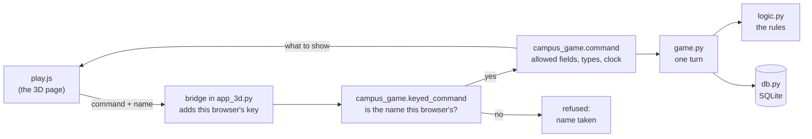

# The Fifth Element (O quinto elemento)

[](https://github.com/afonsodias119-cpu/Plot-Twist---Group-Assignment/actions/workflows/tests.yml)

**Plot Twist** is the course brief (a short mystery game where clues unlock paths and choices change the ending,
[docs/plot-twist-brd.md](docs/plot-twist-brd.md)). **Our game is called *O quinto elemento* / *The Fifth Element*.**
Team project for Introduction to Programming, Nova SBE 2026/27.


**The game in three sentences.** The night before the presentation, a fifth person appears in the photo of your group of
four, and his name, Duarte, is on the cover of your report. You walk a 3D university campus at night, talk to your
teammates, solve four puzzles and collect four proofs before the faculty closes at 23:00. **You win when you hand all
four proofs to the professor in the auditorium:** each one breaks one of Duarte's lies, and his name is crossed out.

## Play online

**https://plot-twist.streamlit.app/**

Pick a language (Português or English), type a name and play. The same name in the same browser continues your game.
Saved games live on the server and can be lost when the free host restarts the app (see [Limits](#limits-and-how-it-could-change)).

## Team

| Name | Student number |
|---|---|
| Afonso Mendo Dias | 78097 |
| Guilherme Osório | 56699 |
| Maria da Cunha | 62123 |
| Mariana Silva | 74705 |

## Run it locally

You need [uv](https://docs.astral.sh/uv/): it installs the right Python and the exact libraries (no `pip` by hand).

```sh
uv sync                                  # install Python 3.12 and the libraries of uv.lock
uv run streamlit run app_3d.py           # the 3D game (the published app) → http://localhost:8501
uv run streamlit run app.py              # the plain version, without 3D (same story and rules)
uv run pytest                            # the 588 tests; all pass on main
```

Stop the app with Ctrl+C. Local saves go to `data/` and are not committed.

## Where to find things (a guide for the reviewer)

```
├── app_3d.py                 the published app: the 3D game inside Streamlit
├── app.py                    the plain version of the same game (no 3D)
├── story.py                  DATA   the scenes, items and endings, in Portuguese and English
├── logic.py                  RULES  conditions, actions, endings (no Streamlit, no database)
├── game.py                   one turn: load the save → ask logic.py → save; names and browser keys
├── db.py                     SAVING the only file with SQL (SQLite)
├── prototypes/campus-3d/     the 3D game: server side (campus_*.py) and page (game3d.html, play.js…)
│   └── README.md             what each of its files does
├── tests/                    588 tests, one file per feature
├── specs/                    one spec per feature, written before its code
│   └── README.md             the specs grouped by topic, and which ones changed or replaced others
├── docs/                     the story, the dialogue script and the team plan (see the table below)
├── assets/                   the pictures (the cover above, the rooms and items of the plain game)
├── .github/workflows/        the tests run on GitHub for every push and pull request
└── pyproject.toml, uv.lock   the pinned libraries
```

To follow **one click from the page to the database and back**, read in this order: `prototypes/campus-3d/play.js`
(`send`) → `app_3d.py` (the bridge) → `prototypes/campus-3d/campus_game.py` (`keyed_command`, `command`) → `game.py` →
`logic.py` → `db.py`.

### The documentation, and its language

The code, the specs, the tests and this README are in **English**. The team's own notes are in **Portuguese**, our
working language; the game itself is in both.

| File | What it contains | Language |
|---|---|---|
| [docs/historia.md](docs/historia.md) | The story as it is today: characters, map, the four proofs, the professor, the endings | Portuguese |
| [docs/story-en.md](docs/story-en.md) | The same story, translated into English | English |
| [docs/guiao-conversas.md](docs/guiao-conversas.md) | Every line of dialogue in the game, with its answers, in both languages | Portuguese (lines in PT and EN) |
| [docs/plano-do-projeto.md](docs/plano-do-projeto.md) | The team plan: course requirements, decisions, phases and the history of every change | Portuguese |
| [docs/plot-twist-brd.md](docs/plot-twist-brd.md) | The course brief we started from | English |
| [docs/imagens.md](docs/imagens.md) | The prompts used to generate the pictures in `assets/` (historical) | Portuguese |
| [docs/maria-campus-3d.md](docs/maria-campus-3d.md) | Maria's handover note of 19/11, when the 3D campus became playable (historical) | Portuguese |
| [specs/README.md](specs/README.md) | The index of the specs | English |
| [prototypes/campus-3d/README.md](prototypes/campus-3d/README.md) | The files of the 3D game | English |

## How to play

| Proof | Where it comes from | It breaks Duarte's claim |
|---|---|---|
| The file history | The group's USB stick (hidden on the study room table), opened on computer 12 with a code the group remembers | "My name has been on the cover since the first draft." |
| The original photo | Rebuilt from its torn pieces with the clerk in the print shop | "There are five people in the photo." |
| The backup of the chats | Saved on computer 12 | "I have weeks of messages in the group." |
| The security recording | The guard's cameras: explain, convince him, plug in the cables, find 23:47 | "I was not even here last night." |

At the professor, "📁 Show evidence" lets you tick the proofs you hand over:
- **all four** → **Case closed**, Duarte's name is crossed out;
- **one missing** → the professor only says how many are missing, and the night goes on;
- **23:00 comes first** → the faculty closes and Duarte keeps the credit.

The story has exactly **two endings** (`story.py`): *Case closed* and *Stolen credit*. In the 3D game a missing proof is
only a warning, so the night ends in *Case closed* or when the faculty closes; *Stolen credit* is the ending of the plain
game (`app.py`) when the evidence is presented with a proof missing.

Wrong choices cost minutes (a wrong proof, a wrong code, being rude, being caught by Duarte's rounds at computer 12);
finding clues is free. Controls: arrows/WASD to walk, **K** to talk or look, a joystick on phones. The in-game phone has
the clues, a diary, a map, messages, the weather and a calendar.

## What we built beyond a solo project

- **A 3D campus** (Three.js) with five rooms, teammates who walk with you and a security desk, inside Streamlit.
- **Conversations with memory:** each line has a right and a wrong answer; people you were rude to answer less, warn the others or lie.
- **Four puzzles:** a hidden-object table, a torn photo, a code worked out from the group's memories and the phone's calendar, and the guard's cables and recordings.
- **A night that does not wait:** a server-side clock, a teammate who leaves at 22:45, and Duarte's rounds.
- **Earlier nights:** the game counts the nights a name has played; new lines appear and the cover photo changes.
- **Your own group:** the three teammates can take your friends' names.
- **Everything in Portuguese and English**, on a computer or a phone, with sounds, voices and a shareable detective card.
- **A name belongs to one browser:** nobody else can continue or overwrite your game.

## How it is built

The 3D page draws the campus and sends **one small command per action** (for example
`{"operation": "talk", "npc": "rita", "node": "start"}`). Python checks it, applies the rules, saves, and sends back
what the page should show. **The browser never decides anything:** the answers, the code, the proofs and the
professor's lines stay on the server.



| Part | Where | What it does |
|---|---|---|
| Story (data) | `story.py`, `prototypes/campus-3d/campus_case.py`, `campus_people.py` | Scenes, items, endings, dialogue, the proofs and Duarte's claims, in both languages. Data only. |
| Rules | `logic.py` | Moving between scenes, items, conditions, endings. No Streamlit and no database. |
| One turn | `game.py` | Loads the save, asks `logic.py`, saves. Also checks names and each name's browser key. |
| Saving | `db.py` | The only file with SQL. |
| 3D server | `prototypes/campus-3d/campus_game.py` (+ `campus_evidence`, `campus_clock`, `campus_memory`, `campus_search`) | Checks every command, runs the clock, the evidence and the hearing, builds the reply. |
| 3D page | `prototypes/campus-3d/game3d.html`, `play.js`, `play.css`, `table.js`, `photo.js` | The Three.js campus, the panel, the phone, the conversations, the puzzles. |
| Apps | `app_3d.py` (published), `app.py` (plain version) | Streamlit entry points. |

**Why it is built this way**
- *Story as data, rules as code:* new scenes or texts change `story.py` or `campus_case.py`, never `logic.py`.
- *The server decides:* a player who reads the page source or edits a request cannot skip a puzzle or win.
- *One file per job* (rules, saving, one turn, screens), so each part can be tested on its own.

The folder is called `prototypes/` for historical reasons: the 3D game started as a prototype and is now the published game.

## Where the data is stored

SQLite files in `data/` (`campus3d.db` for the 3D game, `plot_twist.db` for the plain game), never committed to git.

| Table | One row per | Holds |
|---|---|---|
| `games` | name | the scene, the items, the flags and the ending |
| `nights` | name | tonight's notes: the clock, who was convinced, the proofs kept, the hearing |
| `runs` | finished night | the ending of each night (for the "earlier nights" feature) |
| `keys` | name | the SHA-256 hash of the secret key of the browser that started the name |

Every value goes into SQL through `?` placeholders, never pasted into the query.

## Tests

`uv run pytest` runs **588 tests**; all pass on `main`. GitHub runs them on every push and pull request
(`.github/workflows/tests.yml`, the badge at the top), with a syntax check of the page's JavaScript and
`tests/continuous-conversations.cjs`.

**What they cover**
- The rules and saving: locked actions, items collected once, continuing after a restart, both endings, the plain game's screens.
- Every operation of the 3D server, **accepted and refused**: unknown operations, extra fields, wrong types, invalid names,
  a name used from another browser, actions at the wrong place or time, a wrong code, a damaged save. A refused action
  changes nothing (the tests compare the database file before and after).
- The clock and its costs, Duarte's rounds, the puzzles, the security recording, handing over the proofs and the warning when one is missing.
- That secrets (answers, codes, the professor's lines) never reach the page.
- Balance: a model replays whole nights at different speeds to check that a night can be finished in time.

**What they do not cover:** how the 3D scene looks and feels, sounds and voices, and touch on real phones. We check
these by playing in the browser (computer and phone size, both languages) before each merge.

## Security

- **No secrets:** the app uses no passwords or API keys, so there are none in the repository (`.env` and Streamlit secrets are git-ignored).
- **Access control:** a name belongs to the browser that started it (`specs/name-belongs-to-browser.md`); someone else typing your name is refused.
- **Input validation:** the server accepts only known operations with exactly the expected fields and types; names are cleaned; everything else is refused before anything is saved.
- **Dependencies:** two runtime libraries (`streamlit`, `pillow`), pinned in `pyproject.toml` and `uv.lock`; `uv audit` reports no known vulnerabilities (checked on 23/11/2026). Three.js and the QR library come from a CDN at fixed versions with integrity hashes, so a changed file is not run (`specs/safe-dependencies.md`).

## If something it depends on is unavailable

- **The 3D library (CDN) does not load,** or fails its integrity check: after 12 seconds the page switches to a text mode and the whole game stays playable.
- **The host restarts:** saved games on Streamlit Community Cloud's temporary disk are lost and players start again; the app itself comes back by itself.
- **No other external API is used,** so nothing else can fail from outside.

## Limits and how it could change

- **Saves can disappear** when the host restarts → a hosted database (for example Postgres on Supabase); only `db.py` would change.
- **A name lives in one browser:** without accounts, you cannot continue on another device → accounts with a login.
- **One server process:** commands run one at a time behind a lock (`app_3d.py`) — fine for a class, not for thousands of players.
- **New stories** would be new data files (`story.py`, `campus_case.py`); the rules would not change.

## How we work

1. **A spec first** (`specs/`): why, what, the tests it changes, and when it is done.
2. **Tests next,** then the code, on **its own branch**.
3. **A pull request** that another team member reviews; GitHub runs the tests. Only then is it merged into `main`.
4. A test that was already reviewed only changes with the team's approval, and the spec lists it.
