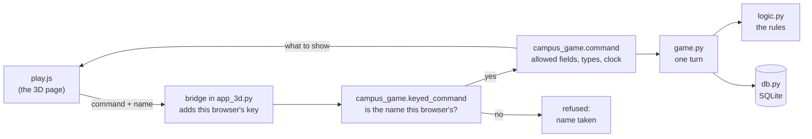

# Plot Twist

A short mystery game where clues unlock paths and choices change the ending.
Team project for Introduction to Programming, Nova SBE 2026/27.

## Play online

**https://plot-twist.streamlit.app/**

The online app runs `app_3d.py` (the 3D campus game) from the `main` branch. Its saved games are temporary: they can be lost when the app restarts.
The plain version without 3D is `app.py`.

## Team

| Name | Student number |
|---|---|
| Afonso Mendo Dias | 78097 |
| Guilherme Osório | 56699 |
| Maria da Cunha | 62123 |
| Mariana Silva | 74705 |

## Getting started

1. Clone this repository with GitHub Desktop.
2. Open a terminal in the project folder and run `uv sync` (installs Python and the libraries).
3. Start the 3D game: `uv run streamlit run app_3d.py`
   (the plain version without 3D is `uv run streamlit run app.py`)
4. Run the tests: `uv run pytest`

## How the project is built

The 3D game is a web page inside Streamlit. The page draws the campus and sends one small command per action
(`{"operation": "talk", "player": …}`); Python checks it, applies the rules, saves, and sends back what the
page should show. The browser never decides anything: answers, codes and the culprit stay on the server.

One click, from the page to the database and back:

The tests run on GitHub on every push and pull request (`.github/workflows/tests.yml`); the badge at the top shows the result for `main`.

| Part | Where | What it does |
|---|---|---|
| Story | `story.py`, `prototypes/campus-3d/campus_case.py`, `campus_people.py` | Scenes, items, endings, dialogue and the three culprit cases, in English and Portuguese. Data only. |
| Rules | `logic.py` | Moving between scenes, items, conditions, endings. No Streamlit and no database. |
| One turn | `game.py` | Loads the save, asks `logic.py`, saves. Also checks names and the browser key of each name. |
| Saving | `db.py` | The only file with SQL. |
| 3D commands | `prototypes/campus-3d/campus_game.py` | Checks every command from the page (allowed fields, types, the night's clock), then calls `game.py`. |
| 3D page | `prototypes/campus-3d/game3d.html`, `play.js`, `play.css` | The Three.js campus, the panel, the phone, the conversations. |
| Apps | `app_3d.py` (published), `app.py` (plain version) | Streamlit entry points. |

The folder is called `prototypes/` for historical reasons: the 3D game started as a prototype and is now the published game.
Every feature has a spec in `specs/` (why, what, limits, done when), written before its tests and code.

### Where the data is stored

SQLite, in `data/campus3d.db` (3D game) and `data/plot_twist.db` (plain game), not committed to git. Tables:
`games` (scene, items, flags, ending per name), `nights` (tonight's notes: clock, evidence, hearing),
`runs` (every finished night, for the "earlier nights" feature) and `keys` (a hash of the secret key of the
browser that started each name). Every value goes in through `?` placeholders, never pasted into SQL.

### Security

- No passwords or API keys are used, so there are no secrets in the repository.
- A name belongs to the browser that started it (`specs/name-belongs-to-browser.md`): someone else typing your name is refused.
- Every command is validated on the server: unknown operations, extra fields, wrong types and invalid names are refused, and a refused action changes nothing.
- Dependencies are pinned (`pyproject.toml`, `uv.lock`) and `uv audit` reports no known vulnerabilities. Three.js and the QR library are pinned versions with integrity hashes (`specs/safe-dependencies.md`).

### What the tests cover (`uv run pytest`)

- The rules, the saves and every operation of the 3D server, accepted and refused: locked routes, items collected once,
  resume after a restart, the four endings, invalid names, bad requests, the clock, the hearing, the culprit cases.
- That secrets never reach the page, and that the page's JavaScript contains the lines each feature needs.
- `tests/continuous-conversations.cjs` runs part of the page's JavaScript in Node.

Not covered by automatic tests: how the 3D scene looks and feels, sounds, and touch controls. These are checked by playing
in the browser (computer and phone size, both languages) before each merge.

### Limits and how it could change

- **Saves can disappear:** Streamlit Community Cloud has a temporary disk, so saved games are lost when the app restarts.
  Next step: a hosted database (for example Supabase); only `db.py` would change.
- **A name lives in one browser:** without accounts, another device cannot continue your game. Accounts with a login would fix this.
- **The 3D needs a CDN:** if Three.js cannot be loaded (or fails its integrity check), the page switches to text mode after 12 seconds and the game stays playable.
- **One server:** all players share one Streamlit process; a lock runs one command at a time, which is fine for a class but not for thousands of players.
- **New stories** would be new data files (`story.py`, `campus_case.py`); the rules would not change.

## How we work

- `main` only changes through pull requests.
- Each feature has a spec in `specs/`, its own branch, and tests.
- Another team member reviews every pull request before it is merged.
