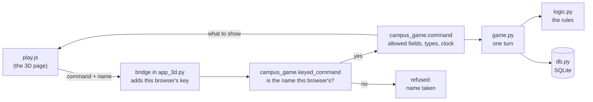

# Plot Twist — The Fifth Element

[](https://github.com/afonsodias119-cpu/Plot-Twist---Group-Assignment/actions/workflows/tests.yml)

A mystery game set on a 3D university campus at night. Clues unlock paths, the people you talk to remember how you
treated them, and what you hand to the professor decides the ending.
Team project for Introduction to Programming, Nova SBE 2026/27.

## Play online

**https://plot-twist.streamlit.app/**

Pick a language (Português or English), type a name and play. Using the same name in the same browser continues your
game. Saved games are kept on the server and can be lost when the free host restarts the app (see [Limits](#limits-and-how-it-could-change)).

## Team

| Name | Student number |
|---|---|
| Afonso Mendo Dias | 78097 |
| Guilherme Osório | 56699 |
| Maria da Cunha | 62123 |
| Mariana Silva | 74705 |

## Run it locally

You need [uv](https://docs.astral.sh/uv/) (it installs the right Python and the libraries; no `pip` or virtualenv by hand).

```sh
uv sync                                  # install Python 3.12 and the exact libraries of uv.lock
uv run streamlit run app_3d.py           # the 3D game (the published app) → http://localhost:8501
uv run streamlit run app.py              # the plain version, without 3D (same story and rules)
uv run pytest                            # every test (about 590); all pass on main
```

Stop the app with Ctrl+C. Local saves go to `data/` and are not committed.

## The game in one minute

The night before the presentation, a fifth person appears in your group's photo. His name, **Duarte**, is on the
cover of the report, and the group got messages that seem to prove he always took part. You have **30 minutes
(22:30–23:00 in the game)** to collect four proofs and hand them to the professor in the auditorium.

| Proof | Where it comes from | It breaks Duarte's claim |
|---|---|---|
| The file history | The group's USB stick (hidden on the study room table), opened on computer 12 with a code the group remembers | "My name has been on the cover since the first draft." |
| The original photo | Rebuilt from its torn pieces with the clerk in the print shop | "There are five people in the photo." |
| The backup of the chats | Saved on computer 12 | "I have weeks of messages in the group." |
| The security recording | The guard's cameras: explain, convince him, plug in the cables, find 23:47 | "I was not even here last night." |

- **All four proofs** handed to the professor → **Case closed**.
- **A proof missing** → the professor only says how many are missing, and the night goes on.
- **23:00** → the faculty closes and Duarte keeps the credit.

Wrong choices cost minutes (a wrong proof, a wrong code, being rude, being caught by Duarte's rounds at computer 12);
finding clues is free. Controls: arrows/WASD to walk, **K** to talk or look, a joystick on phones; the in-game phone
has the clues, a diary, a map, messages, the weather and a calendar.

## What we built beyond a solo project

- **A 3D campus** (Three.js) with five rooms, people who walk with you and a security desk, inside Streamlit.
- **Conversations with memory:** each line has a right and a wrong answer; people you were rude to answer less, warn the others or lie.
- **Four puzzles:** a hidden-object table, a torn photo, a code worked out from the group's memories and the phone's calendar, and the guard's cables and recordings.
- **A night that does not wait:** a server-side clock, a person who leaves at 22:45, and Duarte's rounds.
- **Earlier nights:** the game counts the nights a name has played; new lines and a changing cover photo appear.
- **Your own group:** the three teammates can take your friends' names.
- **Everything in Portuguese and English**, desktop and phone, with sounds, voices and a shareable detective card.
- **A name belongs to one browser:** nobody else can continue or overwrite your game.

## How it is built

The 3D page draws the campus and sends **one small command per action** (for example
`{"operation": "talk", "npc": "rita", "node": "start"}`). Python checks it, applies the rules, saves, and sends back
what the page should show. **The browser never decides anything:** the answers, the code, the proofs and the
professor's lines stay on the server.



| Part | Where | What it does |
|---|---|---|
| Story (data) | `story.py`, `prototypes/campus-3d/campus_case.py`, `campus_people.py` | Scenes, items, endings, dialogue, the proofs and Duarte's claims, in both languages. Data only. |
| Rules | `logic.py` | Moving between scenes, items, conditions, endings. No Streamlit and no database. |
| One turn | `game.py` | Loads the save, asks `logic.py`, saves. Also checks names and each name's browser key. |
| Saving | `db.py` | The only file with SQL. |
| 3D server | `prototypes/campus-3d/campus_game.py` (+ `campus_evidence`, `campus_clock`, `campus_memory`, `campus_search`) | Checks every command, runs the clock, the evidence and the hearing, builds the reply. |
| 3D page | `prototypes/campus-3d/game3d.html`, `play.js`, `play.css`, `table.js`, `photo.js` | The Three.js campus, the panel, the phone, the conversations, the puzzles. |
| Apps | `app_3d.py` (published), `app.py` (plain version) | Streamlit entry points. |

**Why it is built this way**
- *Story as data, rules as code:* new scenes or texts change `story.py`/`campus_case.py`, never `logic.py`.
- *The server decides:* a player who reads the page source or edits a request cannot skip a puzzle or win.
- *One file per job* (rules, saving, one turn, screens), so each part can be tested on its own.

The folder is called `prototypes/` for historical reasons: the 3D game started as a prototype and is now the published
game. Each file in it is explained in [prototypes/campus-3d/README.md](prototypes/campus-3d/README.md).

## Where the data is stored

SQLite files in `data/` (`campus3d.db` for the 3D game, `plot_twist.db` for the plain game), never committed to git.

| Table | One row per | Holds |
|---|---|---|
| `games` | name | the scene, the items, the flags and the ending |
| `nights` | name | tonight's notes: the clock, who was convinced, the proofs kept, the hearing |
| `runs` | finished night | the ending of each night (for the "earlier nights" feature) |
| `keys` | name | the SHA-256 hash of the secret key of the browser that started the name |

Every value goes into SQL through `?` placeholders, never pasted into the query.

## Tests

`uv run pytest` runs about 590 tests; **all pass on `main`**, and GitHub runs them on every push and pull request
(`.github/workflows/tests.yml`, the badge at the top), together with a syntax check of the page's JavaScript and
`tests/continuous-conversations.cjs`.

**What they cover**
- The rules and saving: locked actions, items collected once, continuing after a restart, both endings, the plain game's screens.
- Every operation of the 3D server, **accepted and refused**: unknown operations, extra fields, wrong types, invalid names,
  a name used from another browser, actions at the wrong place or time, a wrong code, a damaged save. A refused action
  changes nothing (the tests compare the database file before and after).
- The clock and its costs, Duarte's rounds, the puzzles, the security recording, handing over the proofs and the warning when one is missing.
- That secrets (answers, codes, the professor's lines) never reach the page.
- Balance: a model replays whole nights at different speeds to check the night can be finished in time.

**What they do not cover:** how the 3D scene looks and feels, sounds and voices, and touch on real phones. We check these
by playing in the browser (computer and phone size, both languages) before each merge.

## Security

- **No secrets:** the app uses no passwords or API keys, so there are none in the repository (`.env` and Streamlit secrets are git-ignored).
- **Access control:** a name belongs to the browser that started it (`specs/name-belongs-to-browser.md`); someone else typing your name is refused.
- **Input validation:** the server accepts only known operations with exactly the expected fields and types; names are cleaned; everything else is refused before anything is saved.
- **Dependencies:** two runtime libraries (`streamlit`, `pillow`), pinned in `pyproject.toml` and `uv.lock`; `uv audit` finds no known vulnerabilities. Three.js and the QR library come from a CDN at fixed versions with integrity hashes, so a changed file is not run (`specs/safe-dependencies.md`).

## If something it depends on is unavailable

- **The 3D library (CDN) does not load,** or fails its integrity check: after 12 seconds the page switches to a text mode and the whole game stays playable.
- **The host restarts:** saved games on Streamlit Community Cloud's temporary disk are lost; players start again. The app itself comes back by itself.
- **No other external API is used,** so nothing else can fail from outside.

## Limits and how it could change

- **Saves can disappear** when the host restarts → a hosted database (for example Postgres on Supabase); only `db.py` would change.
- **A name lives in one browser:** without accounts, you cannot continue on another device → accounts with a login.
- **One server process:** commands run one at a time behind a lock — fine for a class, not for thousands of players.
- **New stories** would be new data files (`story.py`, `campus_case.py`); the rules would not change.

## Repository map

| Folder / file | What is there |
|---|---|
| `app_3d.py`, `app.py` | The two apps |
| `story.py`, `logic.py`, `game.py`, `db.py` | Story data, rules, one turn, saving (shared by both apps) |
| `prototypes/campus-3d/` | The 3D game ([README](prototypes/campus-3d/README.md)) |
| `tests/` | The tests (one file per feature) |
| `specs/` | One spec per feature, written before its code ([index](specs/README.md)) |
| `docs/historia.md` | The story as it is today: characters, map, proofs, endings |
| `docs/guiao-conversas.md` | Every line of dialogue, in Portuguese and English |
| `docs/plano-do-projeto.md` | The team plan and the history of decisions (in Portuguese) |
| `assets/` | The pictures of the plain game and the cover |

## How we work

1. **A spec first** (`specs/`): why, what, the tests it changes, and when it is done.
2. **Tests next,** then the code, on **its own branch**.
3. **A pull request** that another team member reviews; GitHub runs the tests. Only then it is merged into `main`.
4. A test that was already reviewed only changes with the approval of the team, and the spec lists it.
